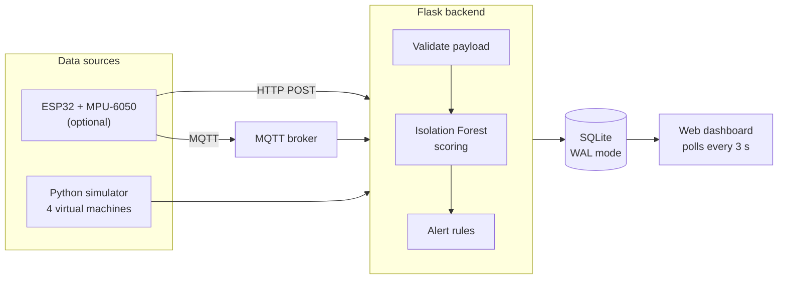
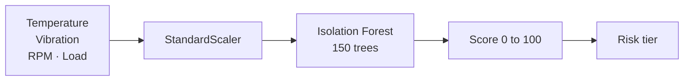

<div align="center">

# 🏭 FactoryTwin

### AI-Driven Digital Twin for Smart Factory Monitoring

*Simulate factory machines, detect anomalies with machine learning, and watch it all on a live dashboard.*

<br>


[](tests/test_results.txt)


<br>

[**Overview**](#-overview) •
[**Features**](#-features) •
[**Architecture**](#-architecture) •
[**Quick Start**](#-quick-start) •
[**API**](#-rest-api) •
[**Hardware**](#-optional-esp32-hardware) •
[**Limitations**](#-limitations)

</div>

---

## 📖 Overview

FactoryTwin is a **Flask web application** that models four factory machines in software, scores their sensor readings with an **Isolation Forest** anomaly detector, raises alerts when something looks wrong, and presents everything on a live, dark-themed dashboard.

It can run entirely on its built-in simulator, or take live vibration data from an **ESP32 + MPU-6050** node over HTTP or MQTT.

> 🎓 **BTech Individual Capstone Project.** Developed and tested on Windows with VS Code.
>
> ⚠️ Machine data is **simulated** by default, and the AI model is trained and evaluated on **synthetic data** generated by scripts in this repository. See [Limitations](#-limitations).

---

## 🧰 Tech Stack

| Layer | Technology |
|---|---|
| **Backend** | Python, Flask |
| **Frontend** | HTML, CSS, JavaScript (Jinja2 templates, Chart.js) |
| **Database** | SQLite |
| **Machine learning** | scikit-learn Isolation Forest, StandardScaler |
| **Messaging** | MQTT via Paho MQTT (configurable broker, HiveMQ Cloud supported) |
| **Hardware** *(optional)* | ESP32, MPU-6050 |
| **Simulation** | Python-based factory simulator |
| **Reports** | CSV, PDF (ReportLab) |
| **Testing** | Python `unittest` |

---

## ✨ Features

<table>
<tr>
<td width="50%" valign="top">

### 🤖 Digital Twin Simulator
Four virtual machines with temperature, vibration, speed, load and production count. Inject any of **7 fault regimes** live from the dashboard.

</td>
<td width="50%" valign="top">

### 🔍 Anomaly Detection
Every reading is scored by an Isolation Forest and mapped to **LOW**, **MEDIUM**, **HIGH** or **CRITICAL**. Falls back to fixed thresholds if the model files are missing.

</td>
</tr>
<tr>
<td valign="top">

### 🚨 Alert Management
Alerts fire when safety limits are crossed, with a **60-second cooldown** to avoid duplicates. Lifecycle: `NEW` → `ACKNOWLEDGED` → `RESOLVED`.

</td>
<td valign="top">

### 🔌 Two Data Sources
Switch each machine, or all of them, between the **simulator** and live **ESP32** data over HTTP or MQTT.

</td>
</tr>
<tr>
<td valign="top">

### 🔐 Role-Based Access
**Operators** monitor, acknowledge alerts and inject faults. **Administrators** also manage users, control the simulator, resolve alerts and view the audit log.

</td>
<td valign="top">

### 📄 Reports
Export filtered data as **CSV** (opens in Excel) or **PDF** (ReportLab) from the Reports page.

</td>
</tr>
</table>

---

## 🏗 Architecture



**Database tables:** `telemetry`, `anomaly_predictions`, `machines`, `alerts`, `maintenance_records`, `audit_logs`.

SQLite runs in WAL mode so the dashboard can read while the simulator writes, and indexes on `telemetry(machine_id, id DESC)` and `anomaly_predictions(telemetry_id)` support the latest-reading lookups. No performance benchmark is published for this project.

---

## 🏭 Monitored Machines

Limits are the values configured in [`config.py`](config.py).

| Machine | Asset | Speed | Temp. limit | Vibration limit | Max load |
|---|---|---|---|---|---|
| `Motor` | Main drive induction motor | 1750 RPM | 85 °C | 4.5 mm/s | 90 % |
| `Conveyor` | Material transfer conveyor | 450 RPM | 70 °C | 3.8 mm/s | 85 % |
| `Pump` | Cooling circuit pump | 2900 RPM | 80 °C | 5.0 mm/s | 92 % |
| `CNC` | 5-axis milling center | 2400 RPM | 90 °C | 5.5 mm/s | 95 % |

### Fault regimes

| Regime | What happens |
|---|---|
| ✅ `NORMAL` | Values stay near baseline |
| 🔥 `HIGH_TEMP` | Temperature climbs toward 95 to 110 °C |
| 📳 `HIGH_VIB` | Vibration rises to 6.5 to 9.5 mm/s |
| ⚙️ `EXCESSIVE_LOAD` | Load reaches 92 to 98 % and speed drops |
| 🐢 `REDUCED_PRODUCTION` | Speed falls to about 40 % of nominal |
| 🛑 `STOPPAGE` | Speed drops to 0 RPM, production stops counting |
| ⚡ `ABNORMAL_SENSOR` | Random sensor spikes |

---

## 🧠 Anomaly Detection



The model is fitted on **normal data only**, so no failure examples are needed for training.

| Risk tier | Score range |
|---|---|
| 🟢 `LOW` | 0.0 to 39.9 |
| 🟡 `MEDIUM` | 40.0 to 64.9 |
| 🟠 `HIGH` | 65.0 to 84.9 |
| 🔴 `CRITICAL` | 85.0 to 100.0 |

### Evaluation on synthetic data

Trained on 12,000 normal samples ([`data/normal_training_data.csv`](data/normal_training_data.csv)) and evaluated on a separate 3,000-sample set ([`data/anomaly_evaluation_data.csv`](data/anomaly_evaluation_data.csv)) where 15 % of rows are labelled anomalies. Results are stored in [`ai_model/model_metrics.json`](ai_model/model_metrics.json).

| Recall | Precision | F1-score | False positive rate |
|:---:|:---:|:---:|:---:|
| **89.73 %** | **72.83 %** | **80.40 %** | **5.88 %** |

> These figures describe performance on data produced by `ai_model/generate_dataset.py`. They are not evidence of performance on real industrial equipment.

---

## 🚀 Quick Start

**Requirements:** Python 3 and `pip`. The project was developed and its tests last run on Python 3.12.10 on Windows; other versions are untested.

### 1. Get the code

```bash
git clone https://github.com/shubhamcores/SmartFactoryDigitalTwin.git
cd SmartFactoryDigitalTwin
```

### 2. Install dependencies

```bash
pip install -r requirements.txt

# Only needed for MQTT features
pip install -r requirements-mqtt.txt
```

### 3. Set up the database

```bash
python database.py
```

Add `--reset` to start over with fresh data.

### 4. Run the app

```bash
python app.py
```

Open **<http://127.0.0.1:5000>** in your browser.

> 💡 On Windows, if `python` or `pip` is not recognised, try `py` and `py -m pip`.

<details>
<summary><b>Optional: regenerate the datasets and retrain the model</b></summary>

<br>

The repository already includes a trained model and datasets. To rebuild them:

```bash
python ai_model/generate_dataset.py
python ai_model/train_model.py
```

</details>

<details>
<summary><b>Optional: configure MQTT and environment settings</b></summary>

<br>

Copy [`.env.example`](.env.example) to `.env` and edit it for your environment. The MQTT broker is configurable and not tied to one provider. Keep your real `.env` out of version control.

</details>

---

## 🖥 Using the Dashboard

Running `python database.py` creates an administrator account and an operator account. The seeded usernames and passwords are defined in [`database.py`](database.py) and are deliberately not repeated here. **Change them before running the app anywhere other than your own machine.**

| | Operator | Administrator |
|---|:---:|:---:|
| View dashboard and machine detail | ✅ | ✅ |
| Acknowledge alerts | ✅ | ✅ |
| Inject faults | ✅ | ✅ |
| Download reports | ✅ | ✅ |
| Start / stop the simulator | | ✅ |
| Switch data source | | ✅ |
| Resolve alerts | | ✅ |
| Manage users and view audit log | | ✅ |

**Pages:** Dashboard · Machine Detail · Alerts · Reports · User Management *(admin)* · Audit Log *(admin)*

---

## 🔌 REST API

<details>
<summary><b>Show all endpoints</b></summary>

<br>

| Method | Endpoint | Access | Purpose |
|:---:|---|---|---|
| `GET` | `/` or `/dashboard` | Operator / Admin | Dashboard |
| `GET` | `/machine/<machine_id>` | Operator / Admin | Machine detail page |
| `GET` | `/api/telemetry/latest` | Operator / Admin | Latest reading and anomaly score per machine |
| `GET` | `/api/telemetry/history/<machine_id>` | Operator / Admin | Telemetry history for one machine |
| `POST` | `/api/simulator/inject_fault` | Operator / Admin | Inject a fault regime |
| `POST` | `/api/simulator/start` | Admin | Start the simulator |
| `POST` | `/api/simulator/stop` | Admin | Pause the simulator |
| `GET` | `/api/datasource/mode` | Operator / Admin | Current data source mode |
| `POST` | `/api/datasource/set_mode` | Admin | Switch between simulator and ESP32 data |
| `POST` | `/api/esp32/telemetry` | None (edge devices) | Receive telemetry from an ESP32 |
| `POST` | `/api/esp32/test_packet` | Operator / Admin | Send an emulated ESP32 packet |
| `GET` | `/api/alerts` | Operator / Admin | List alerts |
| `POST` | `/api/alerts/<id>/acknowledge` | Operator / Admin | Acknowledge an alert |
| `POST` | `/api/alerts/<id>/resolve` | Admin | Resolve an alert |
| `GET` | `/reports/export` | Operator / Admin | Download a CSV or PDF report |

</details>

---

## 🧪 Testing

32 `unittest` tests cover the AI model, alerts, API and authentication, database, MQTT payload validation, report generation and the simulator.

```bash
python tests/run_tests.py
```

The last archived run (32 run, 32 passed, 0 failures, Python 3.12.10 on Windows) is saved in [`tests/test_results.txt`](tests/test_results.txt). Run the suite yourself to confirm results on your machine.

---

## 📡 Optional ESP32 Hardware

The [`hardware/`](hardware/) folder has what you need to feed real vibration data into the app.

| Resource | File |
|---|---|
| Arduino firmware | [`esp32_firmware.ino`](hardware/esp32_firmware.ino) |
| MicroPython firmware | [`esp32_micropython.py`](hardware/esp32_micropython.py) |
| Wiring | [`circuit_diagram.md`](hardware/circuit_diagram.md) |
| Sensor calibration | [`calibration_guide.md`](hardware/calibration_guide.md) |
| Parts list | [`bom.md`](hardware/bom.md) |
| Troubleshooting | [`troubleshooting.md`](hardware/troubleshooting.md) |

The device sends data by HTTP POST to `/api/esp32/telemetry` or over MQTT. With no hardware, use `/api/esp32/test_packet` to try the ingestion path.

---

## 📂 Project Structure

<details>
<summary><b>Show folder layout</b></summary>

<br>

```
SmartFactoryDigitalTwin/
├── ai_model/
│   ├── generate_dataset.py            # Generates the synthetic datasets
│   ├── train_model.py                 # Trains and evaluates the model
│   ├── predict.py                     # Inference and threshold fallback
│   ├── isolation_forest_model.joblib  # Trained model
│   ├── scaler.joblib                  # Fitted StandardScaler
│   └── model_metrics.json             # Evaluation results
├── data/                              # Training and evaluation CSVs
├── hardware/                          # ESP32 firmware and wiring guides
├── mqtt/
│   ├── config.py                      # Topics, TLS settings, payload validation
│   ├── publisher.py                   # Publishes telemetry from an edge node
│   └── subscriber.py                  # Background MQTT listener
├── services/
│   ├── alert_service.py               # Alert rules, cooldown, lifecycle
│   ├── audit_service.py               # Admin action logging
│   ├── auth_service.py                # Password hashing and sessions
│   ├── esp32_service.py               # Edge telemetry validation and ingestion
│   └── report_service.py              # CSV and PDF generation
├── simulation/
│   └── simulator.py                   # Machine simulator and fault injection
├── static/                            # CSS and JavaScript
├── templates/                         # Jinja2 pages
├── tests/                             # unittest suite and archived results
├── app.py                             # Flask app and API routes
├── config.py                          # Settings and machine definitions
├── database.py                        # Schema, connections, seed data
├── requirements.txt                   # Core dependencies
├── requirements-mqtt.txt              # MQTT dependencies
└── .env.example                       # Environment variable template
```

</details>

---

## ⚠️ Limitations

- Machine behaviour is a simplified software simulation, not a model validated against real equipment.
- The anomaly model is trained and scored on synthetic data. Its metrics will not carry over to real machines without retraining on real telemetry.
- The hardware side supports one sensor type only (MPU-6050 vibration).
- `/api/esp32/telemetry` does not require login. Do not expose it to an untrusted network as-is.
- SQLite and the built-in Flask server suit demos and single-machine use, not multi-site production.

---

## 📜 License

Released under the MIT License.

<div align="center">
<sub>Built as a BTech capstone project · Flask · scikit-learn · SQLite · MQTT</sub>
</div>
