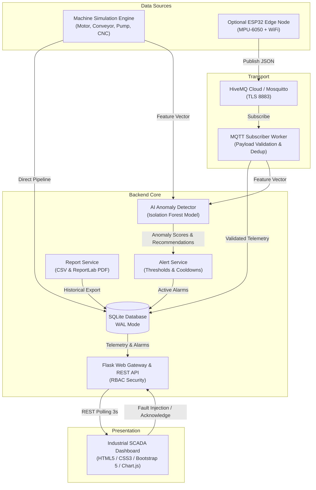

# Stage 4: System Design & Architecture (P_307)
## Architectural Topology, Component Model & Data Flow Diagrams
**Standard**: IEEE 1016 Software Design Description (SDD)  
**Project Code**: P_307 | Version 1.0.0

---

## 1. High-Level Architectural Diagram

The system employs a layered decoupled architecture where data flows unidirectionally from acquisition sources (Internal Physics Simulator or Optional ESP32 Edge Nodes) through transport and analytics layers to the browser-based SCADA interface:

```
+------------------------------------------------------------------------------------------------+
|                                    FACTORYTWIN ARCHITECTURE                                    |
+------------------------------------------------------------------------------------------------+

   [PHYSICAL LAYER] (Optional)                  [SIMULATION LAYER] (Core Standalone)
   +-------------------------+                  +-----------------------------------+
   | ESP32 DevKit V1         |                  | Machine Simulator Thread          |
   | - MPU-6050 IMU          |                  | - Motor (Induction Motor)       |
   | - DS18B20 Temp Probe    |                  | - Conveyor (Belt Conveyor)      |
   | - Edge Threshold Alert  |                  | - Pump (Centrifugal Pump)       |
   +------------+------------+                  | - CNC (5-Axis Milling Machine)  |
                |                               +-----------------+-----------------+
                | (JSON / MQTT)                                   |
                v                                                 | (Direct Python Ingestion)
   +-------------------------+                                    |
   | HiveMQ Cloud Broker     |                                    |
   | - TLS Port 8883         |                                    |
   | - factory/machines/+/   |                                    |
   +------------+------------+                                    |
                |                                                 |
                v                                                 |
   +-------------------------+                                    |
   | MQTT Subscriber Worker  |                                    |
   | - Payload Validation    |                                    |
   | - Message Deduplication |                                    |
   +------------+------------+                                    |
                |                                                 |
                +------------------------+------------------------+
                                         |
                                         v
   +---------------------------------------------------------------------------------------------+
   | INGESTION & DATA PROCESSING PIPELINE                                                        |
   |                                                                                             |
   |   1. SQLite Database Persistence (telemetry table with message_id index)                    |
   |   2. AI Inference Engine (scikit-learn IsolationForest & StandardScaler)                    |
   |   3. Rule-Based Fallback Engine (boundary limit comparisons)                                |
   |   4. Alert & Health Monitoring Service (Threshold evaluations & 60s cooldown deduplication) |
   |   5. Machine State Transition Tracking (machine_status_history)                             |
   +---------------------------------------------+-----------------------------------------------+
                                                 |
                                                 v
   +---------------------------------------------------------------------------------------------+
   | FLASK WEB SERVER & REST API (Application Layer)                                             |
   |                                                                                             |
   |   - Role-Based Access Control (RBAC: Admin vs Operator)                                     |
   |   - REST APIs (/api/telemetry, /api/alerts, /api/simulator, /api/anomalies)                 |
   |   - Automated Reporting Engine (ReportLab PDF & Excel UTF-8 BOM CSV)                        |
   |   - Audit Logging Engine (audit_logs table)                                                 |
   +---------------------------------------------+-----------------------------------------------+
                                                 | (HTTP / JSON / Polling 3s)
                                                 v
   +---------------------------------------------------------------------------------------------+
   | USER INTERFACE & VISUALIZATION LAYER (Browser)                                              |
   |                                                                                             |
   |   - Central SCADA Dashboard (Dark Carbon Industrial Theme, Bootstrap 5)                     |
   |   - Real-Time Chart.js Visualizers (Multi-machine Temp, Vibration, Speed, Production)       |
   |   - Asset Digital Twin Inspector (3D / Gauge Metrics, Anomaly Score Bar, Actions)           |
   |   - Fault Injection Simulation Control Panel (Live Demonstration Tool)                      |
   |   - Alert Management Console (ACK and Admin Resolution)                                     |
   |   - Report Generation Form & Preview Grid                                                   |
   +---------------------------------------------------------------------------------------------+
```

### Mermaid Architecture Diagram



---

## 2. Data Flow Diagrams (DFD)

### Level 0 DFD (Context Diagram)

```
                       +---------------------------------------+
                       |                                       |
                       |                                       |
    [Operator / Admin] | ======= Login Credentials ===========> |
                       | <====== Real-time Dashboard SCADA === |
                       | <====== Operational CSV / PDF ======= |
                       | ======= Fault Injection Commands ===> |  FACTORYTWIN
                       |                                       |  DIGITAL TWIN
                       |                                       |  PLATFORM (P_307)
    [ESP32 / Edge Node]| ======= MQTT Telemetry JSON ========> |
                       |                                       |
    [HiveMQ Broker]    | <====== Telemetry Publish =========== |
                       | ======= Telemetry Stream ===========> |
                       |                                       |
                       +---------------------------------------+
```

### Level 1 DFD (Subsystem Breakdown)

```
  +--------------+
  | Telemetry    |
  | Sources      |
  +-------+------+
          | (Raw Readings)
          v
  +-------+-------+       (Validation Error)
  | 1.0 Validate  | -----------------------------> Discard & Log Warning
  | Payload & Dedup|
  +-------+-------+
          | (Sanitized Telemetry)
          +-------------------------------+---------------------------------+
          |                               |                                 |
          v                               v                                 v
  +-------+-------+               +-------+-------+                 +-------+-------+
  | 2.0 Persist   |               | 3.0 Run AI    |                 | 4.0 Evaluate  |
  | Telemetry     |               | Inference     |                 | Threshold     |
  +-------+-------+               +-------+-------+                 | Rules         |
          |                               | (Anomaly Score)         +-------+-------+
          |                               +---------------->+               |
          | (Record ID)                                     |               |
          v                                                 v               v
  +-------+-------------------------------------------------+---------------+-------+
  |                          5.0 Alert & Health Monitoring Engine                   |
  |             - Applies 60s Cooldown Window per Machine & Condition               |
  |             - Persists New Alerts with Action Recommendations                   |
  +---------------------------------------+-----------------------------------------+
                                          |
                                          v
                              [SQLite Database Store]
                                          |
                                          v
  +---------------------------------------+-----------------------------------------+
  |                     6.0 REST API & Data Serialization                          |
  |          - Ingestion rate calculations, status aggregation, historical filters  |
  +---------------------------------------+-----------------------------------------+
                                          |
                                          v
                                [SCADA Web Dashboard]
```

---

## 3. Telemetry Processing Sequence Diagram

```mermaid
sequenceDiagram
    autonumber
    participant Sim as Simulation Engine
    participant Det as Isolation Forest Detector
    participant DB as SQLite Database
    participant Alt as Alert Service
    participant Web as SCADA Browser

    loop Every 3 Seconds
        Sim->>Sim: Compute Physics Step (Temp, Vib, RPM, Load)
        Sim->>Det: predict(machine_id, temp, vib, rpm, load)
        Det-->>Sim: {is_anomaly, anomaly_score, risk_category, suggested_action}
        Sim->>DB: INSERT INTO telemetry & anomaly_predictions
        Sim->>Alt: evaluate_telemetry_for_alerts(telemetry, anomaly_result)
        alt Threshold Breached AND Cooldown Expired
            Alt->>DB: INSERT INTO alerts (status='NEW')
        end
        Web->>DB: GET /api/telemetry/latest
        DB-->>Web: JSON Telemetry & AI Risk Scores
        Web->>Web: Update Metric Cards, Risk Bars & Chart.js
    end
```
