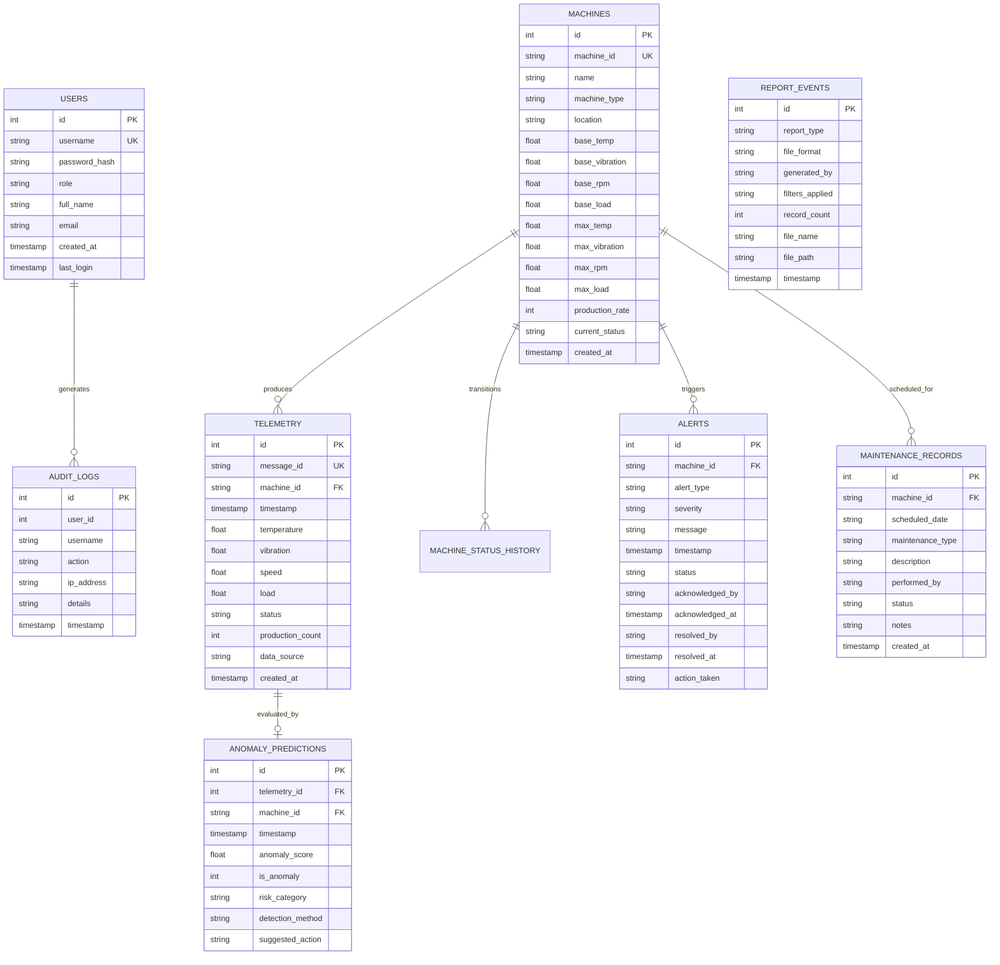

# Stage 5: Database Schema & Entity-Relationship Model (P_307)
## Relational Data Architecture and Indexing Strategy
**Database Engine**: SQLite 3 (WAL Mode Enabled)  
**File Location**: `factory_twin.db` (auto-created in project root)

---

## 1. Entity-Relationship Diagram (ERD)

---

## 2. Table Dictionaries & Schema Definitions

### 2.1 Table: `users`
Enforces Role-Based Access Control (RBAC) across the web platform.
| Column | Data Type | Constraints | Description |
| :--- | :--- | :--- | :--- |
| `id` | INTEGER | PRIMARY KEY AUTOINCREMENT | Unique user identifier. |
| `username` | TEXT | UNIQUE, NOT NULL | Login username (e.g. `admin`, `operator`). |
| `password_hash` | TEXT | NOT NULL | Werkzeug-hashed security password (`scrypt`/`pbkdf2`). |
| `role` | TEXT | NOT NULL, CHECK(`admin`, `operator`) | Access tier governing authorization decorators. |
| `full_name` | TEXT | NOT NULL | Human-readable user name. |
| `email` | TEXT | NULL | Optional user contact email. |
| `created_at` | TIMESTAMP | DEFAULT CURRENT_TIMESTAMP | Account creation date. |
| `last_login` | TIMESTAMP | NULL | Timestamp of most recent authentication. |

---

### 2.2 Table: `machines`
Central registry of physical and simulated industrial assets.
| Column | Data Type | Constraints | Description |
| :--- | :--- | :--- | :--- |
| `id` | INTEGER | PRIMARY KEY AUTOINCREMENT | Internal primary key. |
| `machine_id` | TEXT | UNIQUE, NOT NULL | Industrial identifier (`Motor`, `Conveyor`, etc.). |
| `name` | TEXT | NOT NULL | Asset descriptive title. |
| `machine_type` | TEXT | NOT NULL | Equipment classification (e.g., Induction Motor). |
| `location` | TEXT | NOT NULL | Factory floor bay / plant quadrant. |
| `base_temp` | REAL | NOT NULL | Nominal baseline operating temperature (°C). |
| `base_vibration`| REAL | NOT NULL | Nominal baseline vibration velocity (mm/s). |
| `base_rpm` | REAL | NOT NULL | Nominal baseline rotational speed (RPM). |
| `base_load` | REAL | NOT NULL | Nominal baseline mechanical load percentage (%). |
| `max_temp` | REAL | NOT NULL | Maximum safe continuous operating temperature (°C). |
| `max_vibration`| REAL | NOT NULL | ISO 10816 maximum vibration threshold (mm/s). |
| `max_rpm` | REAL | NOT NULL | Maximum mechanical speed ceiling (RPM). |
| `max_load` | REAL | NOT NULL | Maximum continuous electrical/mechanical load (%). |
| `production_rate`| INTEGER | DEFAULT 5 | Units incremented per nominal simulation cycle. |
| `current_status`| TEXT | DEFAULT 'RUNNING' | Current operational status (RUNNING, WARNING, STOPPED). |

---

### 2.3 Table: `telemetry`
High-frequency time-series sensor repository.
| Column | Data Type | Constraints | Description |
| :--- | :--- | :--- | :--- |
| `id` | INTEGER | PRIMARY KEY AUTOINCREMENT | Unique telemetry reading identifier. |
| `message_id` | TEXT | UNIQUE | Message idempotency / deduplication key. |
| `machine_id` | TEXT | NOT NULL, FOREIGN KEY | References `machines(machine_id)`. |
| `timestamp` | TIMESTAMP | NOT NULL | ISO 8601 acquisition timestamp. |
| `temperature`| REAL | NOT NULL | Instantaneous temperature (°C). |
| `vibration` | REAL | NOT NULL | Instantaneous vibration velocity (mm/s). |
| `speed` | REAL | NOT NULL | Instantaneous shaft speed (RPM). |
| `load` | REAL | NOT NULL | Instantaneous machine load (%). |
| `status` | TEXT | NOT NULL | Asset operational state during reading. |
| `production_count`| INTEGER | NOT NULL | Cumulative total units produced. |
| `data_source`| TEXT | NOT NULL | Ingestion provenance (`SIMULATED`, `MQTT_LIVE`, `ESP32_EDGE`). |

---

### 2.4 Table: `anomaly_predictions`
Audit trail of unsupervised Machine Learning inferences.
| Column | Data Type | Constraints | Description |
| :--- | :--- | :--- | :--- |
| `id` | INTEGER | PRIMARY KEY AUTOINCREMENT | Prediction record key. |
| `telemetry_id` | INTEGER | FOREIGN KEY | References originating `telemetry(id)`. |
| `machine_id` | TEXT | NOT NULL, FOREIGN KEY | Target machine identifier. |
| `timestamp` | TIMESTAMP | NOT NULL | Inference execution timestamp. |
| `anomaly_score`| REAL | NOT NULL | Continuous anomaly risk score normalized (0.0 to 100.0). |
| `is_anomaly` | INTEGER | CHECK (0, 1) | Binary classification (1 = Anomaly, 0 = Normal). |
| `risk_category`| TEXT | CHECK (LOW, MEDIUM, HIGH, CRITICAL) | Industrial risk tier. |
| `detection_method`| TEXT | CHECK (ISOLATION_FOREST, RULE_BASED_FALLBACK) | Algorithm utilized for inference. |
| `suggested_action`| TEXT | NULL | Actionable engineering maintenance guidance. |

---

### 2.5 Table: `alerts`
Operational and safety alarms with lifecycle state tracking.
| Column | Data Type | Constraints | Description |
| :--- | :--- | :--- | :--- |
| `id` | INTEGER | PRIMARY KEY AUTOINCREMENT | Unique alert key. |
| `machine_id` | TEXT | NOT NULL, FOREIGN KEY | Machine that generated the alarm. |
| `alert_type` | TEXT | NOT NULL | Alarm classification code (e.g. `EXCESSIVE_VIBRATION`). |
| `severity` | TEXT | CHECK (INFO, WARNING, CRITICAL) | Industrial urgency tier. |
| `message` | TEXT | NOT NULL | Human-readable condition description. |
| `timestamp` | TIMESTAMP | DEFAULT CURRENT_TIMESTAMP | Alarm trigger timestamp. |
| `status` | TEXT | DEFAULT 'NEW' | Lifecycle status (`NEW`, `ACKNOWLEDGED`, `RESOLVED`). |
| `acknowledged_by`| TEXT | NULL | Username of operator who acknowledged the alarm. |
| `acknowledged_at`| TIMESTAMP | NULL | Timestamp of acknowledgement. |
| `resolved_by` | TEXT | NULL | Username of administrator who resolved the alarm. |
| `resolved_at` | TIMESTAMP | NULL | Timestamp of resolution. |
| `action_taken` | TEXT | NULL | Maintenance action notes documented during resolution. |

---

## 3. Database Indexes for Query Optimization
To ensure rapid query responses under continuous telemetry streaming, the following indexes are constructed:
1. `idx_telemetry_machine_time`: `ON telemetry(machine_id, timestamp DESC)`  
   *Accelerates time-series queries for dashboard charts and machine inspector views.*
2. `idx_telemetry_msg_id`: `ON telemetry(message_id)`  
   *Enforces instantaneous $O(1)$ duplicate lookup for incoming MQTT messages.*
3. `idx_alerts_machine_status`: `ON alerts(machine_id, status)`  
   *Optimizes filtering of pending alarms on the Central SCADA dashboard.*
4. `idx_alerts_timestamp`: `ON alerts(timestamp DESC)`  
   *Speeds up recent alarm feed rendering.*
5. `idx_anomaly_machine_time`: `ON anomaly_predictions(machine_id, timestamp DESC)`  
   *Provides fast retrieval of recent machine anomalies.*
6. `idx_audit_time`: `ON audit_logs(timestamp DESC)`  
   *Ensures responsive pagination in the administrator audit log viewer.*
